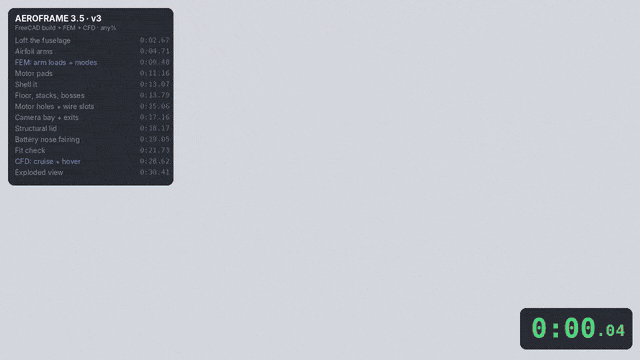

# AeroFrame 3.5 — printed aero frame for the Crux35 parts (v3)

Camera-forward symmetric X, 155 mm motor-to-motor, for EX1404 motors (9×9 M2), 3.5" props,
Caddx Turtle V2 (14 mm), two short stacks, GPS on the deck, battery strapped on top.
Material: PC (polycarbonate) on an Ultimaker S5.

## Repository layout
| Path | What it is |
|---|---|
| `cad/AeroFrame35.FCStd` | FreeCAD model: chassis, lid, reference parts, `Params` spreadsheet (record only) |
| `cad/AeroFrame35.step` | Chassis + lid + fairing, for any CAD tool |
| `cad/AeroFrame35_chassis.stl`, `_lid.stl`, `_hood.stl` | Print files (mm) |
| `cad/reference_parts.step` | Motors, prop disks, camera, boards, GPS, 4S1P pack (fit check only) |
| `scripts/build_frame.py` | The parametric model. Edit `PARAMS`, then `freecadcmd build_frame.py` (or run as a FreeCAD macro) |
| `scripts/fov.py`, `fov_check.py`, `fov_plot.py` | Fisheye camera-view model and the props/frame-out-of-view check |
| `scripts/fem_static.py`, `fem_static_post.py` | Static crash/throttle load cases (gmsh + CalculiX) |
| `scripts/fem_modal.py` | Free-free modal FEM with lumped component masses |
| `scripts/analysis/` | OpenFOAM case setup and post-processing, v2/v3 comparison |
| `scripts/speedrun/` | Blender animation, HUD overlay and GIF scripts for the speedrun video |
| `results/` | FEM and CFD plots and JSON results |
| `media/` | Speedrun videos (MP4), LinkedIn GIFs (landscape + 4:5), renders |
| `v2/` | The previous version (STEP, STL, camera view) for comparison |

The scripts were run from a working folder with an `out/` directory (`build_frame.py` writes it); paths inside are relative to that.

## What changed in v3
- Flared arm roots (fillet effect into the pod): 12 mm blend, +5 mm thickness, top rises 4.5 mm toward the rim.
- Battery nose fairing that also hoods the GPS (separate 6 g print): one M2 screw at the front, two fingers clamped under the pack at the back.
- GPS moved to x = 50 mm (under the fairing); tail exit reduced to 7 mm.

## Key numbers (v3)
- Printed parts: chassis 42.4 g + lid 10.0 g + fairing 6.0 g = **58.4 g** (PC). Volador VX3.5: 70.5 g.
- Camera view: props, motors, frame, fairing, battery and GPS stay out of frame from 10° to 40° uptilt.
- FEM (lid tied, battery footprint held): full throttle 3 MPa; landing on one arm (30 N) 26 MPa (v2: 43); side hit on a motor (20 N) 36 MPa (v2: 25). PC yield ≈ 60 MPa.
  The side-hit peak sits at the sharp arm root under the lid edge (just below it: ~13 MPa); a 2–3 mm fillet there would remove most of it.
- Free-free modes with battery/boards/camera/GPS masses: arms in-plane 120 Hz (v2: 110), pod sideways 180 Hz (168), torsion 226 Hz (192).
- CFD, 15 m/s, airframe without props: drag 0.46 N level (v2: 0.53, −12 %), 0.55 N at 20° nose-down (v2: 0.57, −4 %).
- CFD hover, 4 × 0.8 N actuator disks: download 4.0 % of thrust (v2: 3.8 %; flat 12 mm carbon-style arms: 12.2 %).

## Print notes (PC, Ultimaker S5)
- Chassis: print upright, floor on the bed, brim, doors closed. Tree support **only** under the four motor pads.
- Lid: print upside down (top face on the bed), no supports.
- Fairing: print standing on its open base; the crest is a near-flat roof, so use tree supports inside the crest only (or print in two halves).
- The floor has closed internal cells (double skin) — that is intentional, do not let the slicer fill it solid.
- Walls are 0.85 mm (arms) and 1.4 mm (pod): set line width 0.4 and 2+ walls so they print as solid perimeters.

## Hardware
- 16× M2×6 motor screws from below (check your motor's thread depth).
- 8× M2×8 countersunk self-tapping screws for the lid (or tap the 1.7 mm pilots for M2).
- 1× M2×6 self-tapping screw from inside the pod through the lid into the fairing boss.
- Stack: M2 screws from below through the floor bosses, nylon nuts / your usual standoffs.
- Camera: one M2 through each nose side wall as the pivot (uptilt 10–40°).
- Battery strap: two 15 mm slot pairs at x = ±26 mm. GPS: 26 mm seat under the fairing, with a 10 mm velcro strap.

## Known limits / next steps
- Arms in-plane modes (~120 Hz) are still the softest; a carbon arm core with PC fairings would raise them most.
- At 20° nose-down the remaining drag is mostly the battery's flat rear face and the tail wake; a tail fairing is the next aero step.
- The FEM assumes the lid acts as a bonded shear panel (screws + tongue); the fairing's 6 g is not in the modal masses.
- CFD: steady RANS k-ω SST with wall functions, ~400k cells, no props in cruise; hover props as uniform, swirl-free actuator disks. Use differences between versions, not absolute values.
- Not yet test-printed: check fits (camera width, board sizes, motor pattern) before a full print.

## Note on the FEM numbers
An earlier run carried loads over between CalculiX steps (missing `OP=NEW` on `*CLOAD`), so each case also contained the previous ones.
`scripts/fem_static.py` is fixed and the numbers above and in `results/` are from the corrected run.
The speedrun videos and GIFs were rendered before the fix: their end card says "crash peaks 22–26 MPa"; the corrected range is 26–36 MPa.
