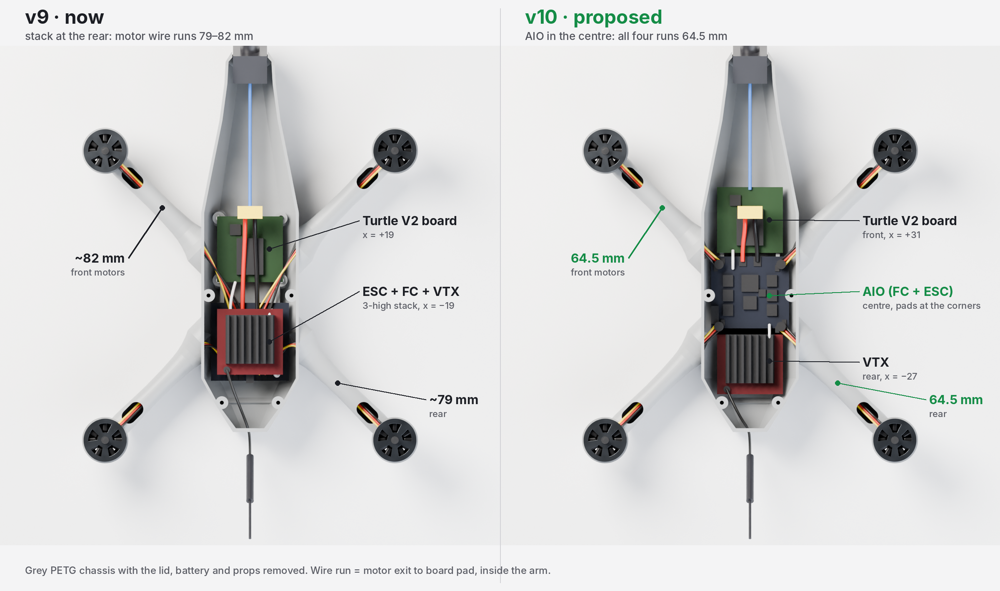
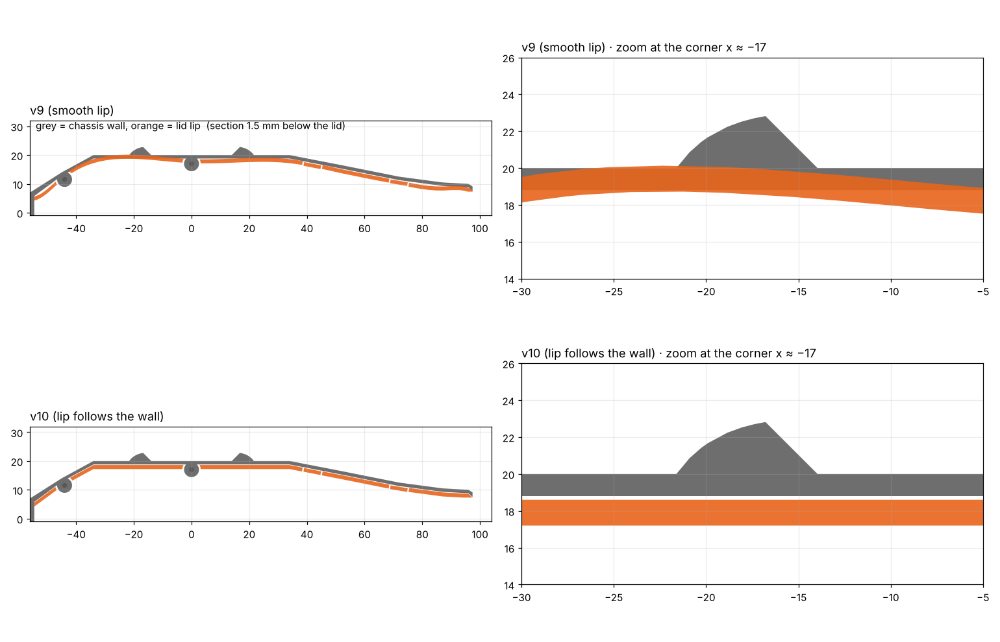
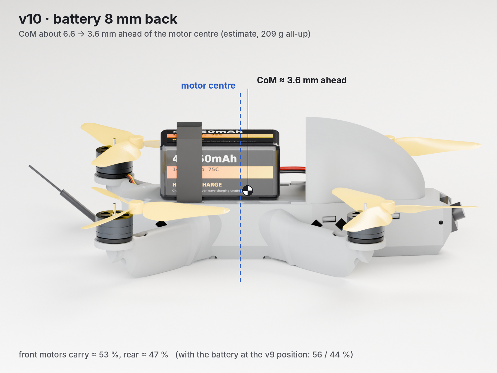

# AeroFrame 3.5 — v10

Electronics re-layout of the v9 frame, so the stock 1404 motor wires reach the board.

## What changed (chassis only)
- **AIO (FC + ESC) in the centre** (x = 0, 25.5 and 20 mm patterns), motor pads at the corners: motor wire runs 79–82 mm → **64.5 mm** on all four arms
- **VTX** on its own mount at the rear, x = −27 mm, next to the antenna exit
- **Turtle V2 board** moved to x = +31 mm, clear of the 32 mm AIO
- **USB-C slot** moved to x = −8 mm
- **Lid lip fixed:** it now follows the faceted pod wall with a 0.2 mm gap all round. In v9 it was a smooth curve that cut into the wall at the corners (up to 0.5 mm) and left gaps of up to 2.8 mm elsewhere — reprint the lid
- Hood unchanged from v9

## Centre of mass (estimate)
~209 g all-up with a 4S 650 mAh LiPo. With the battery in the v9 position the CoM sits ~6.6 mm ahead of the motor centre; sliding the battery **8 mm back** brings it to ~3.6 mm (front/rear motor load ≈ 53/47 %).

## Files
- `cad/AeroFrame35_v10_chassis.stl`, `_lid.stl`, `_hood.stl` — print files (mm)
- `cad/AeroFrame35.step`, `cad/AeroFrame35.FCStd` — full model; `reference_parts.step` — placeholder electronics
- `scripts/build_frame_v10.py` — FreeCAD build script (`FRAME_OUT=<dir> freecadcmd build_frame_v10.py`)

Printed in grey PETG on a Bambu. Board fit was checked against the CAD; FEM and CFD were not re-run for v10 (changes are inside the pod).
